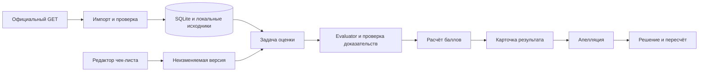

# Архитектура CQA

Прототип реализован. Точные поля и текущие endpoints перечислены в [API_CONTRACT.md](API_CONTRACT.md); ниже сохранены архитектурные решения и контекст исходного плана. Официальные восемь критериев и формула сверены с PDF. Рабочий профиль — Luna/high через OpenAI Responses, подключение в локальном `.env`; Sol доступен отдельно вручную. Текущие требования и сроки — в [памятке команды](HACKATHON_BRIEF.md).

## Поток данных

Приложение работает одним FastAPI-процессом. Длительные модельные вызовы выполняются вне транзакций SQLite, с ограниченной конкурентностью. Задачи и статусы сохраняются в БД. Интерфейс получает прогресс опросом API. После перезапуска незавершённые попытки отмечаются как прерванные, пользователь может их повторить.

## Модули

| Каталог | Назначение | Владелец |
|---|---|---|
| `backend/cqa/models.py` | Общие модели и инварианты | Нариман, изменения согласуются втроём |
| `backend/cqa/main.py` | API и подключение маршрутов | Нариман |
| `backend/cqa/importer.py` | Преобразование исходного экспорта и ID сообщений | Нариман |
| `backend/cqa/evaluator/` | Адаптер модели, инструкция, проверка ответов | Нурхан |
| `backend/cqa/scoring.py` | Расчёт по официальным шкалам, перераспределение N/A и ROUND_HALF_UP | Нариман |
| `backend/cqa/storage.py` | Транзакции, снимки и запросы SQLite | Нариман |
| `frontend/` | Формы, транскрипт, результаты и пересмотр | Олжас |
| `prompts/` | Версионируемая инструкция | Нурхан |
| `fixtures/` | Синтетические примеры | Все |
| `scripts/` | Импорт, экспорт и запуск | Нариман |

## Данные

Исходная реплика имеет timestamp, speaker и text. Импорт добавляет message_id вида `conversation_id:0000` по исходному порядку. Timestamp сохраняется дословно. Чаты используют MM:SS, звонки ISO 8601 с зоной. Для клика по аудио нужна подтверждённая опора начала записи. При отсутствии опоры показывается реплика и общий плеер.

В evaluator передаётся полный диалог с ролями. Главный объект оценки — operator. Реплики клиента, бота и системные события дают контекст.

### Таблицы SQLite

| Таблица | Основные поля |
|---|---|
| `conversations` | id, group_id, language, channel, transcript_json, audio_url, content_hash, imported_at |
| `checklists` | id, title, created_at |
| `checklist_versions` | id, checklist_id, version, criteria_json, scoring_policy_json, config_hash, created_at |
| `evaluation_jobs` | id, idempotency_key, conversation_id, checklist_version_id, status, attempt, error_code, started_at, finished_at |
| `evaluations` | id, job_id, conversation_snapshot_json, checklist_snapshot_json, original_results_json, original_total_json, model_info_json, revision |
| `appeals` | id, evaluation_id, criterion_id, comment, status, created_at |
| `review_decisions` | id, appeal_id, action, replacement_result_json, reason, evaluation_revision, created_at |

Публичный ID диалога уникален в рамках набора. При пересечении ID между group_id импорт должен сохранить отдельный составной ключ или версию. Внешний display-ID остаётся исходным. Оценка хранит снимки, чтобы изменение набора или чек-листа не меняло историю.

Включите foreign keys и WAL. Решение по апелляции и увеличение revision выполняются атомарно. Транзакция проверяет ожидаемую revision, чтобы два клиента не перезаписали решение друг друга.

## Endpoints

Рабочие endpoints описаны в [текущем API-контракте](API_CONTRACT.md). Для загрузки используется JSON тела запроса либо локальные DEV/учебные примеры; получение контрольного файла по подписанной ссылке выполняет `scripts/fetch_dataset.py`.

| Метод и путь | Запрос / результат |
|---|---|
| `GET /health` | Состояние приложения и версия |
| `GET /api/config` | Состояние подключения модели без ключей |
| `POST /api/datasets/import` | `{dataset: DatasetExport}` либо `{source: "dev" \| "demo"}` → число загруженных, обновлённых и неизменённых диалогов |
| `GET /api/conversations` | Фильтры group_id, language, channel → краткий список |
| `GET /api/conversations/{id}?group_id=DEV` | Нормализованный диалог со стабильными ID реплик |
| `GET /api/checklists` | Чек-листы и доступные версии |
| `POST /api/checklists` | Создание чек-листа с первой конфигурацией |
| `POST /api/checklists/{id}/versions` | Сохранение новой неизменяемой версии |
| `POST /api/evaluation-jobs` | `{conversation_id, group_id, checklist_id, checklist_version, idempotency_key?}` → `202 {job_id,status,error,evaluation_id}` |
| `GET /api/evaluation-jobs/{id}` | Статус, ошибка или evaluation_id |
| `GET /api/evaluations/{id}` | Исходная и действующая оценки, история и revision |
| `GET /api/evaluations/export` | Скачиваемые JSON-снимки оценок |
| `POST /api/evaluations/{id}/appeals` | `{criterion_id,comment,idempotency_key}` → апелляция |
| `POST /api/appeals/{id}/decision` | `{action,reason,replacement_result,expected_revision,idempotency_key}` → новый итог |

Для отсутствующего объекта — 404, невалидного входа — 422, устаревшей ревизии — 409. Ошибка внешнего провайдера сохраняется в job и отражается в UI. Один повторный запрос с тем же idempotency_key возвращает существующий результат.

## Оценка и модель

Evaluator получает Conversation и ChecklistVersion. Возвращает EvaluationDraft с результатом для каждого criterion_id. Порядок критериев берётся из конфигурации. Внутри ответа отсутствует окончательный общий балл, его рассчитывает сервер.

Каждый CriterionResult содержит статус, сырой ответ, объяснение, evidence с message_id и точной цитатой, при необходимости проверенный диапазон и флаг грубой ошибки. Для пропущенного действия диапазон должен быть непустым и существовать в диалоге.

После ответа модели сервер проверяет ID критериев, ровно один результат на каждый, тип и диапазон ответа, разрешённость N/A и ссылки на существующие реплики. Ошибка доказательства вызывает ограниченный повтор или needs_review.

Автоматического кэша модельных результатов сейчас нет: новый запуск отправляется оценщику. Повтор HTTP-запроса с тем же `idempotency_key` возвращает ту же операцию; другое содержимое с уже использованным ключом отклоняется. Если добавлять кэш позже, его ключ должен включать содержимое диалога, конфигурацию, модель, параметры и prompt_version. Новый критерий сохраняется как новая версия и участвует в следующем запуске.

Адаптер использует таймаут и учёт usage. `LLM_MODEL`, `LLM_BASE_URL` и `LLM_API_KEY` задаются сервером. Расходы каждого вызова и всех повторов суммируются в стоимость полной оценки. Тарифы и ограничения расчёта описаны в [отчёте сравнения](BENCHMARK_RESULTS.md).

## Интерфейс и хранение состояния

Состояние редактируемой формы локально до сохранения. Оценка, версии и апелляции сохраняются сервером. UI всегда показывает version_id и статус. После смены диалога устаревший ответ не должен заменять текущую карточку.

Для демонстрации доступны отдельные действия подачи апелляции и решения проверяющего. Guide не требует регистрации. API и UI запускаются локально, схема ролей отражается в сценарии.

## Внешние сведения, которых пока нет

- Независимая разметка качества и официальный Ground Truth.
- Продуктовая база знаний с актуальными тарифами и правилами идентификации.
- Финальное объявление о доступе к контрольному набору и форме сдачи ссылки.
- Индивидуальный слот защиты и окончательная площадка второго дня.

Старт — 7 ноября, 12:00; дедлайн — 8 ноября, 12:00 по Астане, согласно публичному расписанию. Часовое окно контроля включает выгрузку и push. Количественного норматива нагрузки организаторы не задали; текущий один процесс и SQLite не следует объявлять проверенным решением для произвольной промышленной нагрузки. При росте нагрузки очередь, workers и хранилище потребуют отдельного развития и измерений. Звонки сейчас обрабатываются по тексту; аудио не считается прослушанным.

Основание стека — [FastAPI](https://fastapi.tiangolo.com/tutorial/), [Pydantic](https://docs.pydantic.dev/latest/concepts/models/), [SQLite](https://docs.python.org/3.13/library/sqlite3.html), [Vite](https://vite.dev/guide/).
